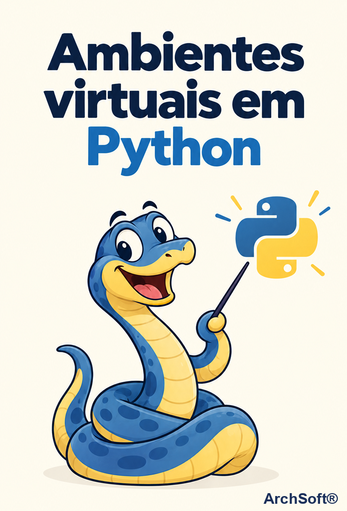

# Ambientes virtuais em Python

## Por que usar um ambiente virtual



Quando instalamos bibliotecas Python diretamente no sistema operacional, todas ficam no mesmo lugar, compartilhadas por todos os projetos. No começo isso parece prático, mas conforme os projetos crescem, os problemas aparecem: um projeto pode precisar de uma versão antiga de uma biblioteca enquanto outro exige a versão mais recente — e como só é possível manter uma versão instalada por vez, atualizar para um projeto quebra o outro.

É este o problema que o ambiente virtual resolve: o módulo **venv** **isola as dependências do projeto**, de modo que **cada projeto** tenha suas bibliotecas de **maneira separada** do sistema operacional.

Com essa abordagem, cada projeto passa a ter a sua própria "caixa de ferramentas": é possível trabalhar em projetos diferentes, cada um com as versões exatas das bibliotecas de que precisa, sem que um interfira no outro. Como benefício extra, replicar o mesmo ambiente em outros computadores também se torna muito mais simples.

## Requisitos mínimos

Antes de criar um ambiente virtual, é necessário ter o **Python 3** instalado na máquina — o módulo `venv` já vem incluído por padrão a partir do Python 3.3, sem necessidade de instalação adicional.

Para verificar se o Python já está instalado, execute no terminal:

```bash
python --version
```

Se o Python não estiver instalado, baixe a versão mais recente no site oficial:

- **Windows:** [python.org/downloads](https://www.python.org/downloads/) — baixe o instalador e, durante a instalação, **marque a opção "Add python.exe to PATH"** para poder executar o Python pelo terminal.
- **Linux:** na maioria das distribuições o Python 3 já vem instalado. Caso contrário, instale pelo gerenciador de pacotes (ex.: `sudo apt install python3` no Debian/Ubuntu) ou baixe o código-fonte em [python.org/downloads/source](https://www.python.org/downloads/source/).

## Criando um ambiente virtual do zero

O primeiro passo é criar uma pasta para o projeto, manualmente ou pelo terminal:

```bash
mkdir my_project
```

Em seguida, acesse a pasta do projeto:

```bash
cd my_project/
```

Para criar o ambiente virtual, execute no terminal, dentro da pasta criada:

```bash
python -m venv .venv
```

O nome do ambiente virtual, por convenção, é `.venv`, mas qualquer outro nome pode ser utilizado. A partir do comando acima, será criada a pasta que conterá a versão do Python instalada na máquina e todas as bibliotecas que serão instaladas no projeto. Ou seja, as bibliotecas do `my_project` ficarão apenas nesse diretório, e não diretamente no sistema operacional, como era feito antes.

No entanto, criar o ambiente não é suficiente: é necessário ativá-lo.

No Linux:

```bash
source .venv/bin/activate
```

No Windows, o comando de ativação é diferente:

No Git Bash:

```bash
source .venv/Scripts/activate
```

No PowerShell:

```powershell
.venv\Scripts\Activate.ps1
```

Com o ambiente ativado, é possível **instalar as dependências sem que haja futuros conflitos**: basta executar `pip install` seguido do nome da biblioteca desejada.

## Replicando ambientes

Conforme mencionado no início, os ambientes virtuais facilitam a replicação do ambiente em outras máquinas. Isso se deve à possibilidade de exportar um arquivo com todas as bibliotecas que o projeto contém:

```bash
pip freeze > requirements.txt
```

O comando acima cria um arquivo com todas as bibliotecas presentes no ambiente virtual. Por exemplo:

```text
flake8==3.7.9
Flask==1.1.2
Flask-API==2.0
```

Para rodar o projeto em outra máquina, não é necessário baixar as dependências uma a uma. Basta executar:

```bash
pip install -r requirements.txt
```

O comando acima instala automaticamente todas as bibliotecas presentes no arquivo `requirements.txt`.

Por fim, para **desativar o ambiente virtual**:

```bash
deactivate
```

Em resumo, isolar as dependências de cada projeto em um ambiente virtual próprio é uma prática recomendada.

## Referências

- [Ambientes virtuais em Python — Alura](https://www.alura.com.br/artigos/ambientes-virtuais-em-python) — artigo que serviu de base para este documento.

- [Documentação oficial do venv](https://docs.python.org/3/library/venv.html) — referência completa do módulo `venv` na documentação do Python.

